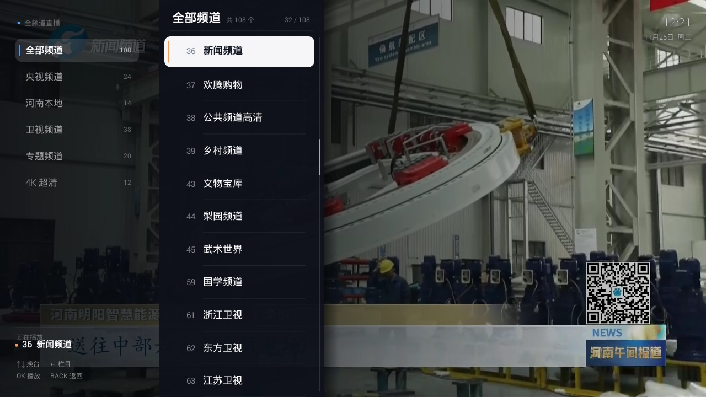

# 河南直播 · 全频道

一个极简的 IPTV 直播播放器：直接播放运营商 CDN 上公开的频道地址，绕开原厂 App 被锁在
「默认频道 / 试看」状态机里、只能看 CCTV1 的问题。

纯 Java、单 Activity、一个自绘 `View`，**无 AndroidX、无第三方库**，APK 只有 30 KB 左右。




## 特性

- **频道菜单**：左栏分类（全部 / 央视 / 河南本地 / 卫视 / 专题 / 4K）+ 右侧通高单列频道表，
  选中是白色胶囊、正在播的频道带橙色竖条，右侧细滚动条，右上角时间日期。
- **换台**：遥控器 `↑↓` 逐台、`←` 进分类、`→` / `OK` 回列表、数字键直选频道号；
  手机上点画面开关菜单、点条目播放、上下拖动滚动。
- **画面比例**：16:9 满屏；4:3 标清按 DAR 4:3 处理，高度铺满、水平居中，不裁切不拉伸。
  遥控器 `菜单` 键可在「自适应 / 拉伸铺满」之间切换，选择会记住。
- **记忆**：记住上次看的频道与上次停留的栏目；启动时短暂屏蔽按键，避免桌面 OK 键余波误开菜单。
- **健壮性**：播放失败有中文提示、按键去抖、清单缺失时回退内置示例。

## 分支

| 分支 | 适配 | 说明 |
| :--- | :--- | :--- |
| `main` | Android 10+ 通用 | minSdk 21 / targetSdk 34，分区存储，清单可放 App 私有目录或内置 assets |
| `android-phone` | 手机 / 平板 | 触屏操作，窄屏自适应，打开即横屏，APK 内置频道清单 |
| `android-4x` | Android 4.4 盒子 | minSdk 19，含这台 Amlogic 播放器的画幅补偿（97.5%×75% 那条经验值） |

三个分支的菜单、按键、播放逻辑一致，差异只在**存储访问**和**画面尺寸计算**。

## 下载安装

到 Releases 页面下载对应 APK：

| 文件 | 适用 | 说明 |
| :--- | :--- | :--- |
| `halive19-tv-4x.apk` | Android 4.4 电视 / 盒子 | 需要自己放频道清单（见下） |
| `halive19-phone.apk` | Android 10+ 手机 / 平板 | **已内置频道清单**，装上即用，横屏 |

```sh
adb install -r halive19-phone.apk
```

## 频道清单

清单就是一个数组：

```json
[
  {"no": 1, "name": "中央一套高清", "url": "http://.../index.m3u8"},
  {"no": 31, "name": "河南卫视高清", "url": "http://.../index.m3u8"}
]
```

**放在哪**（按优先级）：

| 分支 | 首选位置 | 回退 |
| :--- | :--- | :--- |
| `main` / `android-phone` | `/sdcard/Android/data/com.example.halive19/files/channels.json` | `/sdcard/tvhome19/` → `/sdcard/halive19/` → 内置示例 |
| `android-4x` | `/sdcard/tvhome19/channels.json` | `/sdcard/halive19/` → 内置兜底 |

```sh
adb push channels.json /sdcard/Android/data/com.example.halive19/files/channels.json
# Android 4.4：
adb push channels.json /sdcard/tvhome19/channels.json
```

**怎么生成**：从运营商的下发接口取频道表，按 `categoryCode == "ALL"` 去重后映射成上面的格式。

```sh
curl -sS -k -4 -H 'Content-Type: application/json' -X POST \
  -d '{"packageName":"com.brlf.tvlivelaunch","boxType":"unicast","status":"normal","inList":"None","siteCode":"mobile","deviceType":"STB","appKey":"com.brlf.tvlivelaunch"}' \
  'https://yd-live.hnnrtv.com:33766/live/channelListVer' | python3 -m json.tool
```

> 仓库里只带 `channels.sample.json`（3 条示例）。真实清单含运营商地址，不入库；
> `build.sh` 若发现仓库根目录有 `channels.json`，会自动把它打进 APK 的 assets。

## 构建

不依赖 Gradle，用 SDK 里的 `aapt2` / `d8` / `apksigner` 手动构建：

```sh
# 需要 Android SDK（platform 34 + build-tools 34）与 JDK
export ANDROID_HOME=/path/to/android-sdk
cd halive19 && sh build.sh
```

产物：`halive19-debug.apk`。首次构建若找不到签名密钥，会用 `keytool` 现生成一个 debug keystore。

## 目录结构

```
halive19/
├── build.sh                     手动构建脚本
├── channels.sample.json         示例清单
├── docs/                        README 截图
└── app/src/main/
    ├── AndroidManifest.xml
    ├── assets/                  内置清单（构建时生成）
    ├── res/                     图标、应用名
    └── java/com/example/halive19/
        ├── MainActivity.java    播放页、按键、清单加载
        ├── ChannelMenuView.java 自绘频道菜单（分类 + 列表 + 触摸）
        ├── TvVideoView.java     按比例自适应 / 拉伸铺满
        └── Channel.java
```

## 说明与限制

- 频道流是运营商 CDN 上的公开单播地址，**本项目不伪造任何账号或 token**，也不访问鉴权服务器；
  能播不代表有授权，仅供个人自用与研究。
- 地址可能随运营商调整失效，届时按上面的方法重新生成清单即可。
- `android-4x` 的 `97.5% × 75%` 画幅系数是量特定固件（CM201-1 / Android 4.4.2）得来的，
  换设备会偏，所以只保留在那个分支；`main` 用标准算法。
- `main` 与 `android-phone` 已通过构建与启动冒烟测试，但未在 Android 10+ 真机上长期使用。
